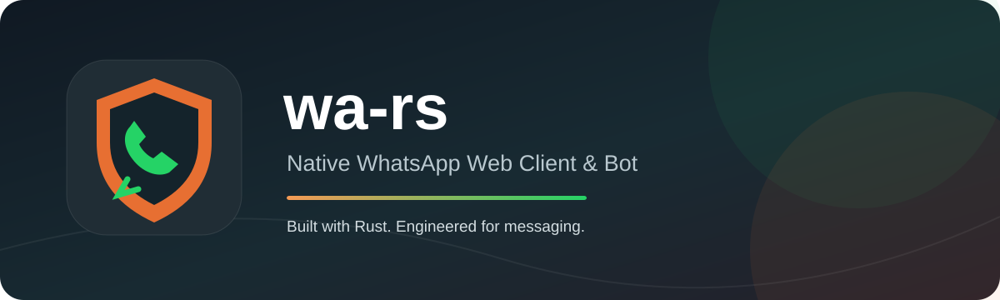

<div align="center">



# WA-RS

### Native Rust WhatsApp WebSocket Bot

A lightweight WhatsApp bot implementation written in Rust.

[](https://www.rust-lang.org/)
[](https://tokio.rs/)
[](LICENSE)

**Native Rust. Direct connection. Lightweight architecture.**

</div>

---

## About

WA-RS is an experimental WhatsApp bot implementation written in Rust.

The project explores a native connection and message-processing architecture using WebSocket communication, Noise handshake, binary node encoding, cryptographic utilities, and Signal session storage.

The implementation is actively developed. Availability is limited to what is implemented in the current source. This project does not claim complete WhatsApp protocol coverage.

## Features

- Native Rust implementation
- Asynchronous runtime with Tokio
- WebSocket connection
- Noise handshake implementation
- Binary node encoding and decoding
- Pairing and local credential storage
- Signal session storage
- Encrypted message processing
- Basic command handling
- Atomic local storage writes

## Architecture

The application follows a compact connection and message-processing flow:

```text
Application startup
       |
       v
Load local credentials and Signal store
       |
       v
Establish WebSocket connection
       |
       v
Noise handshake
       |
       v
Send login or pairing payload
       |
       v
Receive encrypted WebSocket frames
       |
       v
Decrypt and decode binary nodes
       |
       v
Dispatch incoming events
       |
       v
Process and decrypt messages
       |
       v
Command handler
       |
       v
Encrypt and send reply
````

### Project Structure

```text
wa-rs/
├── assets/
│   ├── banner.svg
│   └── logo.svg
├── src/
│   ├── adv.rs
│   ├── binary.rs
│   ├── creds.rs
│   ├── crypto.rs
│   ├── main.rs
│   ├── noise.rs
│   ├── pairing.rs
│   ├── proto.rs
│   ├── signal.rs
│   ├── storage.rs
│   ├── tokens.json
│   ├── tokens.rs
│   └── wamsg.rs
├── Cargo.toml
├── Cargo.lock
├── LICENSE
└── README.md
```

### Technology

| Component           | Technology                    |
| ------------------- | ----------------------------- |
| Language            | Rust                          |
| Async runtime       | Tokio                         |
| Connection          | WebSocket                     |
| Serialization       | Serde / JSON                  |
| Protocol structures | Prost                         |
| Cryptography        | RustCrypto and related crates |
| Storage             | Local filesystem              |

### Requirements

* Rust toolchain

* Cargo

* Internet connection

* A WhatsApp account for pairing and testing

### Installation

Clone the repository:

```bash
git clone https://github.com/vianarasyaaa/bot-wa-rust.git
cd bot-wa-rust
```

Build the project:

```bash
cargo build --release
```

Run:

```bash
cargo run --release
```

Follow the terminal instructions to complete the pairing process.

### Basic Command

The currently implemented basic test command is:

```text
!ping
```

Expected response:

```text
pong 🏓 dari bot WhatsApp Rust native
```

Additional commands depend on the current source implementation.

### Session Security

Authentication credentials and Signal session data are stored locally.

Important:

* Never publish your `auth/` directory.

* Never commit credential or session files.

* Keep private keys and account information out of public repositories.

* Back up session data securely.

* Remove local session data only when you intend to pair again.

The repository `.gitignore` excludes local authentication data and build artifacts.

### Development

Format the source:

```bash
cargo fmt
```

Check formatting:

```bash
cargo fmt --check
```

Build optimized release:

```bash
cargo build --release
```

Run tests:

```bash
cargo test
```

### Roadmap

* Native Rust project foundation

* WebSocket connection

* Noise handshake

* Local credential storage

* Signal session storage

* Basic message handling

* Basic `!ping` command

* Expand command handler

* Improve protocol compatibility

* Improve error handling and diagnostics

* Expand automated tests

Roadmap items may change as development progresses.

### Disclaimer

This project is an independent, experimental implementation and is not affiliated with, endorsed by, or officially connected to WhatsApp or Meta.

Use responsibly and comply with applicable terms and policies. Protocol behavior may change without notice.

### License

This project is licensed under the MIT License. See LICENSE.

